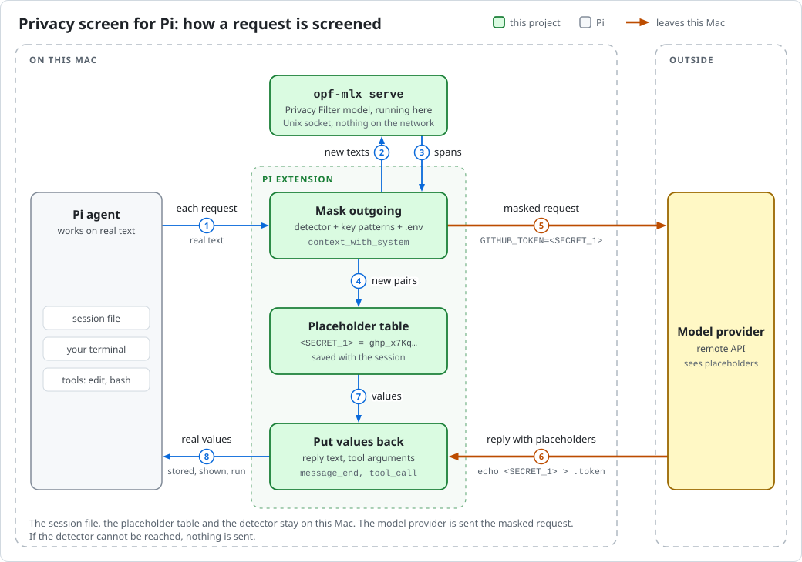
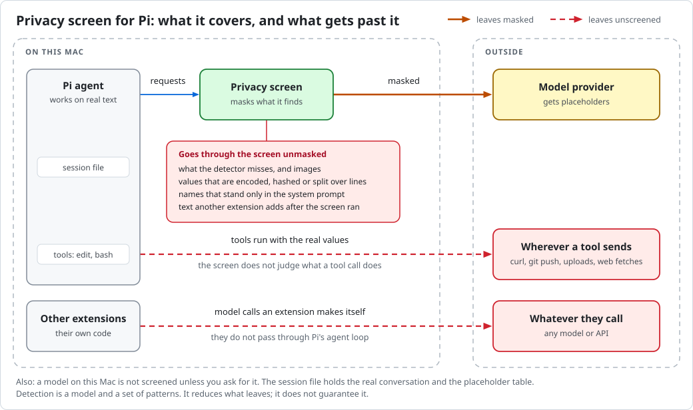

# OpenAI Privacy Filter: architecture note

Everything here was read from the original artifacts, not inferred from names
or from similar models.

| Artifact | Pinned at | Used for |
|---|---|---|
| `github.com/openai/privacy-filter` | commit `f7f00ca7fb869683eb732c010299d901457f19c3` | model, runtime, decoding source (`opf/_model`, `opf/_core`, `opf/_common/label_space.py`, `opf/_api.py`) |
| `huggingface.co/openai/privacy-filter`, directory `original/` | revision `7ffa9a043d54d1be65afb281eddf0ffbe629385b` | `config.json`, `model.safetensors`, `viterbi_calibration.json` |
| `original/model.safetensors` | 2,798,984,088 bytes, sha256 `9c262cbe68a0c8a50590a648ef8341a2b7d3be1fa11dfb79893fe0b03ce57b5c` | weights: 107 tensors, 1,399,486,832 parameters |

The parameter count computed from the module definitions equals the count in
the safetensors header exactly, so no tensor is unexplained.

Sections 1 to 15 describe the model, 16 and 17 this implementation of it.
Sections 18 and 19 describe two things built on top that are not in the
original: a local detection service, and a privacy screen for the Pi coding
agent that uses it.

## 1. Configuration (`original/config.json`)

| Key | Value | Meaning |
|---|---|---|
| `num_hidden_layers` | 8 | transformer blocks |
| `hidden_size` | 640 | residual stream width |
| `vocab_size` | 200064 | embedding rows (tokenizer uses ids 0..200018) |
| `num_attention_heads` / `num_key_value_heads` / `head_dim` | 14 / 2 / 64 | grouped-query attention, 7 query heads per KV head |
| `bidirectional_left_context` / `_right_context` | 128 / 128 | attention band on each side |
| `sliding_window` | 257 | total band including self; only validated, never used directly |
| `num_experts` / `experts_per_token` / `intermediate_size` | 128 / 4 / 640 | mixture-of-experts feed-forward |
| `rope_theta`, `rope_scaling_factor`, `rope_ntk_alpha`, `rope_ntk_beta`, `initial_context_length` | 150000, 32, 1, 32, 4096 | rotary position encoding |
| `num_labels` | 33 | token classes |
| `default_n_ctx` / `max_position_embeddings` | 128000 / 131072 | window length / initial RoPE table size |
| `encoding` | `o200k_base` | tiktoken encoding |
| `param_dtype` | `bfloat16` | storage and compute dtype of the weights |

Not in the config, taken from code defaults: `swiglu_limit = 7.0`,
`packed_geglu = False`, RMSNorm `eps = 1e-5`, SwiGLU `alpha = 1.702`.

## 2. Checkpoint tensors

All BF16 except `sinks` (F32). `n` is the block index 0..7.

| Name | Shape | Role |
|---|---|---|
| `embedding.weight` | [200064, 640] | token embedding |
| `block.n.attn.norm.scale` | [640] | pre-attention RMSNorm |
| `block.n.attn.qkv.weight`, `.bias` | [1152, 640], [1152] | fused q/k/v projection, `y = x Wᵀ + b`; 1152 = 64 × (14 + 2 + 2) |
| `block.n.attn.sinks` | [14] | one attention-sink logit per query head, stored in log2 units |
| `block.n.attn.out.weight`, `.bias` | [640, 896], [640] | attention output projection |
| `block.n.mlp.norm.scale` | [640] | pre-MLP RMSNorm |
| `block.n.mlp.gate.weight`, `.bias` | [128, 640], [128] | expert router |
| `block.n.mlp.swiglu.weight`, `.bias` | [128, 640, 1280], [128, 1280] | expert layer 1, laid out [expert, in, out]: `y = x W[e] + b[e]` |
| `block.n.mlp.out.weight`, `.bias` | [128, 640, 640], [128, 640] | expert layer 2, also [expert, in, out] |
| `norm.scale` | [640] | final RMSNorm |
| `unembedding.weight` | [33, 640] | classifier, no bias |

## 3. Forward pass

One window of `T` tokens, batch size 1 (what the reference runtime does).

```
ids                                                     [1, T]         int32
x = embedding[ids]                                      [1, T, 640]

repeat for 8 blocks:
  h       = rmsnorm(x)
  qkv     = h Wqkvᵀ + bqkv                              [1, T, 1152]
  q, k, v = qkv[..., :896], [..., 896:1024], [..., 1024:]
            q -> [1, T, 14, 64]    k, v -> [1, T, 2, 64]
  q, k    = rope(q), rope(k)            then each multiplied by 64^(-1/4)
  q       -> [1, T, 2, 7, 64]           query head i reads KV head i // 7
  s[t, g, j, w] = q[t, g, j] · k[t + w - 128, g]        [1, T, 2, 7, 257]
            -inf where t + w - 128 is outside [0, T)
  s       = concat(s, sinks[g, j] * ln 2)               [1, T, 2, 7, 258]
  p       = softmax(s)[..., :257]                       sink column dropped
  a[t, g, j] = sum_w p[t, g, j, w] * v[t + w - 128, g]  -> [1, T, 896]
  x       = x + a Woutᵀ + bout

  h       = rmsnorm(x)                                  [T, 640]
  r       = h Wgateᵀ + bgate                            [T, 128]
  e, val  = top4(r);   wts = softmax(val)               [T, 4]
  for each selected expert e:
      u = h W1[e] + b1[e]                               [1280]
      z = min(u[:640], 7) * sigmoid(1.702 * min(u[:640], 7)) * (clip(u[640:], -7, 7) + 1)
      y = z W2[e] + b2[e]                               [640]
  x       = x + sum_e wts[e] * y[e]

x      = rmsnorm(x)
logits = x Wunembedᵀ                                    [1, T, 33]
logp   = log_softmax(logits)                            [T, 33]
```

## 4. Attention behavior

- **Bidirectional and banded on every layer.** Token `t` attends to tokens
  `t-128 .. t+128` that exist in the window. There is no causal mask.
- **Attention sink.** A learned per-head scalar joins the softmax as an extra
  logit and is then discarded, so the weights over real tokens sum to less than
  one. It is not a token and has no value vector. Because it is always finite,
  the softmax is never over an empty set.
- **Scaling.** Queries and keys are each scaled by `64^(-1/4)` after RoPE; there
  is no separate `1/sqrt(d)` on the scores.
- **Grouping.** Query heads 0..6 use KV head 0, heads 7..13 use KV head 1. The
  sinks are indexed in the same order.
- **Padding.** The reference can mask padded keys in a batch. Single-text
  inference never pads.
- **Receptive field.** Eight layers of ±128 give ±1024 tokens. Nothing else
  mixes tokens, so the logits for token `t` depend only on tokens within 1024
  positions of it.

## 5. Position encoding

Rotary embedding applied to queries and keys only, with YaRN-style frequency
blending. With `d = 64`, pair index `i = 0..31`:

```
freq[i]   = 150000 ^ (2i / 64)
low, high = 32 * ln(4096 / (32 * 2π)) / ln(150000),  32 * ln(4096 / (1 * 2π)) / ln(150000)
          = 8.0928, 17.3980
mask[i]   = 1 - clip((i - low) / (high - low), 0, 1)
inv[i]    = mask[i] / freq[i] + (1 - mask[i]) / (32 * freq[i])
c         = 0.1 * ln(32) + 1 = 1.346574
cos[p, i] = c * cos(p * inv[i]),   sin[p, i] = c * sin(p * inv[i])
```

Pairs are interleaved: `(x[2i], x[2i+1])` rotates to
`(x[2i] cos - x[2i+1] sin, x[2i+1] cos + x[2i] sin)`. The constant `c` multiplies
both the sine and cosine tables, so it scales queries and keys, and the scores
by `c²`. Pairs 0..8 keep their original frequency, pairs 18..31 are slowed by
32, and pairs 9..17 blend. The same table serves every head. Position `p` is
the index within the current window, starting at 0. The table is built for
131072 positions and extended if a window is longer.

The tables are float32 and are built on the CPU. The reference computes
`freq[i]` with PyTorch's float32 `pow`. This port computes it in double
precision and rounds once, because an error in a frequency grows with the
position. On this machine PyTorch's result is one unit in the last place away
from the correctly rounded value for 2 of the 32 frequencies, so the two tables
differ by up to `1.2e-7 * p`: 4e-5 at position 4096 and 1.3e-3 at position
131071. Attention only sees differences of angles between tokens at most 128
apart, where this is 1.5e-5 of a radian at worst. It is not visible in the
logits (section 17).

The angle `p * inv[i]` is formed in float32, as in the reference, so it is
rounded more coarsely the larger it is: to 1.2e-4 of a radian between 2,048
and 4,096 radians, to 4e-3 near 100,000. A text's scores therefore depend
slightly on where it sits. Measured on the released model: the same 2,430
tokens placed 1,024 to 120,000 positions later get float32 logits that differ
by 0.01 to 0.11 rms, and by up to 5.7 at single tokens; no best label changed.
With the angles computed in double precision the same shifts change nothing
beyond round-off (3e-5), so the cause is the table's rounding and not the
model. The reference's formula is kept because it reproduces the reference's
results. In bfloat16 the cosines and sines are also rounded to 8 bits before
use, and logits at two offsets differ by about 0.26 rms, as any two bfloat16
runs do. This is why a window cannot reproduce a single pass bit for bit
(section 16).

## 6. Expert routing

The router runs on the normalized input and produces 128 logits per token. The
four largest are selected, and the mixing weights are a softmax over only those
four values. The reference divides the weights by 4 and later multiplies the
sum by 4; both are exact in binary floating point, so they cancel. Each expert
is a two-layer MLP with the clamped SwiGLU from section 3. The gate half is the
first 640 outputs of layer 1 and the linear half is the last 640 (contiguous
halves, not interleaved). The `+1` on the linear half is unconditional.

Per token, 4 of 128 experts run, which is where "1.5B total, 50M active"
comes from: 50,571,632 parameters touch a given token, excluding the embedding
table.

Choosing the four best experts is the one discrete step in the network. When a
token's fourth and fifth router scores are closer than the rounding noise of
the computation, two correct implementations can choose differently, and the
logits around that token then differ by far more than round-off. Section 17
has a measured case. In bfloat16 the noise is larger, such choices differ more
often, and this is part of why bfloat16 logits drift apart.

## 7. Normalization

Pre-norm RMSNorm before attention, before the MLP, and once before the
classifier:

```
y = x * rsqrt(mean(x², last axis) + 1e-5) * scale
```

computed in float32 and cast back to the residual dtype. There are no biases
and no mean subtraction.

## 8. Classifier output

A bias-free linear layer from 640 to 33, giving logits `[1, T, 33]`, followed
by a float32 log-softmax. Class 0 is `O`. Classes 1..32 are four boundary tags
`B, I, E, S` for each of eight categories in this order: `account_number`,
`private_address`, `private_date`, `private_email`, `private_person`,
`private_phone`, `private_url`, `secret`. So class `1 + 4c + b` is boundary `b`
of category `c`. The config carries no label names; the reference infers this
"v2" label set from `num_labels = 33`. It matches `id2label` in the repository's
transformers-format config.

## 9. Precision

The checkpoint's precision is bfloat16, and the reference keeps the residual
stream in bfloat16 with float32 only in specific places.

| Stage | Reference dtype |
|---|---|
| embedding, residual stream, qkv and output projections, RoPE rotation | bf16 |
| `q · k` dot products | bf16, then upcast to f32 |
| band mask, sink, softmax | f32 |
| `p · v` weighted sum | bf16 |
| RMSNorm internals | f32, result cast to bf16 |
| router logits, top-k, softmax | f32 |
| expert MLPs | f32 on CPU (weights upcast per use); bf16 in the CUDA Triton kernels |
| logits | bf16, upcast to f32 for log-softmax |

The CPU and CUDA paths of the reference therefore differ numerically from each
other. Only the CPU path can run on a Mac, so it is the parity target.

The reference also has a switch that is off by default,
`OPF_ATTN_LOW_PRECISION` (`opf eval --attn-low-precision`). It keeps the rotary
tables, the attention scores, the sink and the softmax in bfloat16. It is not
implemented here.

bfloat16 keeps 8 significant bits, so *where* a value is rounded matters as
much as which dtype a step runs in. Measured on PyTorch 2.15 (CPU), by
comparing each operation with exact arithmetic rounded once:

| Operation in the reference | Where it rounds |
|---|---|
| `F.linear(x, W, b)` in bf16 | once, after the bias is added (not after the product) |
| `einsum` / `matmul` in bf16 | once, after a float32-accurate sum |
| `x1 * cos - x2 * sin` (RoPE) | three times: each product, then the difference; `cos` and `sin` are rounded to bf16 first |
| `q * qk_scale` (tensor times Python number) | once; the number stays in float32 |
| `scores.float()` | the scores are already rounded to bf16 when they reach the softmax |
| `W[..., :-1].to(V.dtype)` | attention weights are rounded to bf16 before they meet the values |
| `x + proj`, `x + t` | once per residual addition |

MLX rounds the same way in every row but one: it converts a Python number to
the array's dtype before multiplying, so `q * 0.35355339` would use
0.35351563. That flips the last bit of 2.6 % of all query and key entries.
`opf_mlx.model.scale` multiplies in float32 and rounds once instead.

Float32 matrix products need care on Apple GPUs. MLX 0.32.4 runs them in a
reduced-precision mode by default on GPUs with neural accelerators (measured
relative error 1e-3 instead of 1e-6), controlled by `MLX_ENABLE_TF32`, which
defaults to on in MLX's `utils.h` and is read at
the first GPU matmul of the process. The reference turns the equivalent
PyTorch mode off, and the expert MLPs and the router run in float32, so
`opf_mlx` sets `MLX_ENABLE_TF32=0` on import, measures the precision when a
model is loaded, and refuses to run on a device where it is reduced. The
expert layers multiply with `gather_mm`, which runs in other kernels than
`matmul` and is reduced by the same switch (measured 8e-4), so both are
measured.

## 10. Tokenization and text offsets

- `tiktoken.get_encoding("o200k_base").encode(text, allowed_special="all")`.
  Literal `<|endoftext|>` or `<|endofprompt|>` in the input become their
  special ids (199999, 200018). Empty input returns no spans.
- Offsets come from bytes. Each token's bytes are concatenated and decoded as
  UTF-8 with replacement. A token's character range starts at the character
  containing its first byte and ends after the character containing its last
  byte, so a token that splits a multi-byte character is widened outward.
  Offsets are Python string indices (code points).
- If the decoded text differs from the input (for example a lone surrogate
  becomes U+FFFD), spans index the decoded text, `decoded_mismatch` is true,
  and the result carries a `warning`.

## 11. Windowing

Tokens are cut into consecutive, non-overlapping windows of `n_ctx` tokens.
Each window is an independent forward pass with positions restarting at 0, and
its log-probabilities are written back by absolute token index. Nothing is
truncated. `n_ctx` is the caller's override if given; otherwise the reference
uses 4096 on CPU and `default_n_ctx = 128000` elsewhere. Tokens near a window
edge lose the context on the far side of the cut. (Section 16 describes this
port's alternative, overlapping windows.)

## 12. Decoding

Default is constrained Viterbi over the whole token sequence (all windows
together), in float32, maximizing

```
start[y0] + sum_t logp[t, y_t] + sum_t trans[y_(t-1), y_t] + end[y_last]
```

| From | Allowed next | Bias name |
|---|---|---|
| start of text | `O`, `B-*`, `S-*` | none |
| `O` | `O` | `background_stay` |
| `O` | `B-*`, `S-*` | `background_to_start` |
| `B-x`, `I-x` | `I-x` | `inside_to_continue` |
| `B-x`, `I-x` | `E-x` | `inside_to_end` |
| `E-x`, `S-x` | `O` | `end_to_background` |
| `E-x`, `S-x` | `B-*`, `S-*` | `end_to_start` |
| last token | must be `O`, `E-*`, `S-*` | none |

Every other transition scores `-1e9`. The six biases come from
`viterbi_calibration.json` next to the checkpoint (`operating_points.default.biases`);
all six are `0.0` in the released file, so only the structural constraints act.
Ties resolve to the lowest class index. If no final score is finite, or the
path length is wrong, the reference falls back to per-token argmax. Argmax is
also selectable as a mode.

## 13. Spans and redaction

1. Labels to token spans with a tolerant state machine (it also accepts the
   ill-formed sequences argmax can produce).
2. Token spans to character spans; empty ones are dropped.
3. Trim leading and trailing whitespace from each span (on by default).
4. Optionally discard overlapping spans within a label (off by default).
5. Keep a left-to-right non-overlapping subset, ordered by start, then longer
   first, then label.
6. Output mode `typed` keeps labels; `redacted` replaces every label with
   `redacted` and every placeholder with `<REDACTED>`.
7. Placeholder is the label uppercased with non-alphanumeric runs replaced by
   `_`, in angle brackets: `private_person` becomes `<PRIVATE_PERSON>`.
8. `redacted_text` substitutes each kept span with its placeholder.

Result schema (version 1): `schema_version`, `summary` (`output_mode`,
`span_count`, `by_label` sorted by label, `decoded_mismatch`), `text`,
`detected_spans` (`label`, `start`, `end`, `text`, `placeholder`),
`redacted_text`, and `warning` only on a decode mismatch. (opf-mlx also warns
when an input was split into windows; see section 16.)

## 14. Ambiguities and how each was resolved

| Question | Resolution | Evidence |
|---|---|---|
| The Hugging Face repo has two checkpoints. Which is the original? | `original/`. The top-level files are a transformers re-layout: split q/k/v, renamed tensors, and an extra `score.bias`. | `checkpoint_download.py` fetches `original/*`; headers compared |
| What does `sliding_window` mean? | 257 = 128 + 128 + 1, a consistency check only. The transformers config says 128 (per side); gpt-oss uses 128 as a causal lookback. | `_validate_encoder_artifact_contract`, `sdpa` |
| Are all layers banded? | Yes. gpt-oss bands only even layers. | `AttentionBlock.__init__` |
| Expert layer 2 is 640 × 640. Is it [in, out] or [out, in]? | [in, out]: `y = x W[e]`. The shape cannot tell. | `MLPBlock.__init__`, `_batched_linear_with_parity` |
| SwiGLU halves: interleaved or contiguous? | Contiguous. gpt-oss interleaves. | `swiglu(packed=False)`; no `packed_geglu` in config; Triton kernel agrees |
| Is the `+1` on the linear half conditional? | No, despite a comment tying it to the packed variant. | `swiglu`, Triton kernel line 221 |
| Router weights: softmax over 128 or over the top 4? | Over the top 4 values. | `MLPBlock.forward` |
| Where is the `1/sqrt(d)`? | Split as `d^(-1/4)` on q and on k, applied after RoPE. | `AttentionBlock.forward` |
| Which RoPE pairing and which frequencies? | Interleaved pairs, YaRN blend, magnitude `c` on both tables. | `RotaryEmbedding`, `_apply_rotary_emb` |
| `dtypes.json` omits the norm scales. What dtype are they? | BF16 in the file, used as float32. | safetensors header; `RMSNorm` |
| Does the classifier have a bias? | No. | `Transformer.__init__`; header |
| What precision is the reference? | bf16 stream with float32 islands; CPU and CUDA paths differ in the expert MLPs. | section 9 |
| Does a bf16 linear layer round before its bias is added? | No. Product and bias are summed in float32 and rounded once. | measured on PyTorch against exact arithmetic |
| Is `q * qk_scale` computed with the scale rounded to bf16? | No. PyTorch keeps a Python number in float32 for the product. | measured; attention outputs agree in 57-82 % of entries one way and 97-99.9 % the other |
| What is the context length? | Device-dependent in the reference: 4096 on CPU, 128000 otherwise. | `_resolve_n_ctx` |
| Are long inputs truncated? | Never. They are windowed without overlap. | `example_to_windows` |
| Which tokenizer? | tiktoken `o200k_base`, not the repo's `tokenizer.json`. | `load_inference_runtime` |
| Where do label names come from? | Inferred from `num_labels`. | `resolve_label_space_from_config` |

## 15. Properties worth testing

- Parameter count and every tensor name, shape, and dtype match section 2.
- Changing a token more than 1024 positions away leaves a token's logits
  unchanged (section 4).
- Attention weights plus the sink's share sum to one.
- Results do not depend on `n_ctx` whenever the text fits in a single window.
- A token's expert outputs are the same bits whatever other tokens are
  processed with it.
- Whatever the window policy, every token is scored exactly once; with the
  `halo` policy it also sees its whole receptive field or the end of the text.
- Logits, decoded labels, spans, and redacted text agree with the PyTorch CPU
  reference on the same text and the same `n_ctx`.

All of these are tests. `tests/test_model.py` checks the network against an
independent NumPy implementation of this note, `tests/test_golden.py` against
outputs recorded from the reference, and `tests/test_parity.py` against the
reference itself when PyTorch is installed (`reference/`).

## 16. This implementation

```
text -> Tokenizer -> token ids -> plan_windows -> Transformer (MLX) -> logits
     -> log-softmax (NumPy) -> Viterbi or argmax -> token spans
     -> character spans -> placeholders
```

| Module | Concern |
|---|---|
| `config`, `labels` | read and validate `config.json`; label space |
| `weights` | safetensors reader; every tensor's name, shape and dtype is checked, nothing missing or extra |
| `model` | the network, `mlx.core` and `mlx.nn` only |
| `tokenizer` | tiktoken plus byte-to-character offsets |
| `windows` | how an input longer than `n_ctx` is split |
| `decoding`, `spans` | Viterbi, argmax, spans, placeholders (NumPy and plain Python) |
| `pipeline` | `PrivacyFilter`: the one place where the parts meet |
| `checkpoint` | locate, download and verify the pinned release |
| `env`, `precision` | what this machine is; whether float32 products are exact |
| `cli` | the `opf-mlx` command |
| `serve` | the local detection service: transport only, standard library only (section 18) |

Choices that are not the reference's:

- **Devices.** `gpu` by default, `cpu` on request; never switched silently.
  `n_ctx` defaults to the checkpoint's 128000 on the gpu and to 4096 on the
  cpu, which is what the reference does for CUDA and CPU.
- **Precision.** bfloat16 as stored, or the same weights as float32
  (`dtype="float32"`), which costs twice the memory and no time. No
  quantization.
- **Windows.** The default policy is the reference's consecutive windows. A
  split is reported in the result's `warning` and as a `PrivacyFilterWarning`,
  because tokens next to a cut see less context. The `halo` policy feeds each
  window 1024 more tokens on each side than it keeps (the receptive field of
  section 4; `halo` sets another width), so every kept token sees the tokens
  it would see in one pass, and nothing is reported. It takes the fewest
  windows that can do this: one if the input fits, otherwise
  `2 + ceil(max(0, tokens - 2 (n_ctx - halo)) / (n_ctx - 2 halo))`. For a long
  input that is twice the work at `n_ctx = 4096` and under 2 % more at
  128000. A window too small to
  keep a token between two halos is refused when the filter is built. Halo
  windows do not reproduce one pass bit for bit, because positions restart in
  every window (section 5); section 17 has what they do achieve.
- **Experts.** The reference's CPU path copies the weights of each token's
  four experts and multiplies one token at a time (`torch.bmm`). This port
  sorts the (token, expert) pairs by expert and gives them to `mx.gather_mm`,
  which multiplies every row by its own expert's matrix in place and takes a
  run of rows that share an expert in one step. A row's result is the same
  bits alone or in company (tested), so nothing about the other tokens leaks
  into it. On the cpu the products are the reference's bit for bit (measured:
  all 9,720 rows of two layers); on the gpu they are float32-accurate in
  another summation order. The router runs once on all tokens, as in the
  reference.
- **Memory.** The size of the weights is compared with what the machine has
  before loading: an error if it cannot fit, a warning if it is tight.
- **Downloads.** Only the three files of the pinned revision, each verified by
  size and SHA-256. An existing file that is not the release is never replaced
  unless asked (`--force`).
- **Chunking.** Attention runs over 128 queries at a time against the keys
  they can see, and the experts over 16384 tokens at a time, each step
  finished before the next begins. Both bound memory. The expert step size
  does not change a bit of the result; the attention step size changes at most
  the rounding of float32 sums.

## 17. Measured

Apple M5 Max, 128 GiB, macOS 26.6.2, Python 3.13.13, MLX 0.32.4; reference:
PyTorch 2.15.0 on the same CPU. 2026-11-23.

**Agreement with the reference** on the released checkpoint. Logits were
recorded for 7 texts of 15 to 2,430 tokens (3,349 tokens in all; they are about
5 rms and up to 28), redaction results for 13 cases:

| Weights | Device | Largest logit difference | rms, per text | Tokens whose best label differs | Redaction results equal |
|---|---|---|---|---|---|
| float32 | gpu | 3.7e-5 | under 6e-6 | 0 of 3,349 | 13 of 13 |
| float32 | cpu | 3.2e-5 | under 6e-6 | 0 | 13 of 13 |
| bfloat16 | gpu | 7.1 | 0.09 to 0.33 | 1 | 13 of 13 |
| bfloat16 | cpu | 7.0 | 0.09 to 0.19 | 1 | 13 of 13 |
| reference bfloat16 against reference float32 | | 7.2 | 0.07 to 0.45 | 1 | 13 of 13 |

In bfloat16 one differing last bit early on moves later roundings, so whole
logits drift apart; the reference drifts as far from its own float32 result.
The one token whose best label differs is a near-tie in a 20-token text (`O`
at 5.97 against `I-private_person` at 5.91 on the gpu, 6.09 against 5.84 on the
cpu, where the reference has 5.94 and 6.16). The reference's own two
precisions disagree on the token before it. Neither changes a result. What can
be checked exactly is each sublayer on its own: given the reference's input,
attention reproduces the reference's output in 96.8 to 100 % of the entries,
the expert layers in 99.95 % or more, and the classifier in 99.86 % or more.

**A wider sample.** The recorded texts are few, so 60 further passages of 200
tokens were scored (12 from a text dense with private data, 48 from the Python
language reference; 12,000 tokens). No best label differs from the reference's,
in either precision, on either device.

- bfloat16: the logits differ from the reference's by 0.61 rms per passage on
  the gpu and 0.57 on the cpu (medians; 0.85 at most). The reference's own two
  precisions differ by 0.81 (1.11 at most). Drift is larger on ordinary prose
  than on the recorded texts.
- float32: all 60 passages agree to 6e-5 on the gpu, and 59 on the cpu. In the
  remaining one, a token's fourth and fifth router scores are 0.110512368 and
  0.110512152 in the reference. The cpu run, whose residual stream differs by
  round-off, takes the other expert, and logits near that token differ by up
  to 3.2 (section 6). It is one near-tie among the sample's 96,000 choices of
  experts.

**Speed.** `uv run python scripts/benchmark.py` times `redact`, from text to
result, on the Python language reference that ships with Python. bfloat16,
fastest of 3:

| Tokens | gpu | tokens/s | peak memory | cpu | tokens/s |
|---|---|---|---|---|---|
| 128 | 29 ms | 4,500 | 3.2 GiB | 127 ms | 1,000 |
| 2,048 | 63 ms | 32,700 | 3.7 GiB | 869 ms | 2,400 |
| 4,096 | | | | 1.66 s | 2,500 |
| 8,192 | 186 ms | 44,100 | 4.2 GiB | | |
| 32,768 | 730 ms | 44,900 | 5.0 GiB | | |
| 128,000 | 2.88 s | 44,400 | 5.8 GiB | | |

Repeated runs differ by about 5 %, and by 15 % at 128 tokens on the cpu.
Loading takes 0.2 s. The forward pass is about 2.5 s of the time at 128,000
tokens; most of the rest is Viterbi decoding.

float32 weights are faster on short inputs and the same from 8,192 tokens up:
14 ms at 128 tokens, 49 ms at 2,048 and 2.92 s at 128,000 on the gpu, peaking
at 5.2 to 9.0 GiB; 65 ms at 128 tokens and 0.8 s at 2,048 on the cpu. What
bfloat16 adds on short inputs is the upcast of each layer's expert weights to
float32, about 5 GB written per pass.

What the text is does not matter. One paragraph repeated, which reaches fewer
experts than varied text, takes the same time within 3 % on the gpu and
within 8 % on the cpu.

The grouped product (section 16) was chosen for the gpu. One product per
expert in use, the obvious alternative, costs about a hundred small steps per
layer: 94 ms instead of 29 at 128 tokens on the gpu, and 142 instead of 63 at
2,048. On the cpu the alternative is slower on short inputs (176 ms against
124 for the forward pass at 128 tokens) and faster on long ones (689 ms
against 858 at 2,048 tokens, 1.19 s against 1.65 s at 4,096).

The reference takes 11.5 s for one 2,430-token text on this CPU (6.2 s with
float32 weights). opf-mlx takes 1.0 s for the same text on the cpu and 0.07 s
on the gpu.

The reduced-precision float32 mode (section 9) gives nothing at 128 tokens,
8 % more tokens per second at 2,048 and 23 to 25 % more from 8,192 up. It
moves the bfloat16 logits of varied text by 0.6 rms, about as much as they
differ from the reference on such text; no best label changed in a
2,048-token sample. It is left off because the reference leaves its equivalent
off.

**Windows.** Two texts of about 12,000 tokens were scored in one pass and in
windows of 4,096 tokens: 3 consecutive windows, or 5 with a halo of 1,024. The
table gives the difference from one pass on the gpu; on the cpu the rms values
are within 10 % of these.

| Text | Weights | Windows | Log-probability difference, rms (largest) | Decoded labels that differ | Spans that differ |
|---|---|---|---|---|---|
| records, 12,150 tokens, 720 spans | float32 | consecutive | 0.36 (17) | 2 | 3 |
| | | halo | 0.08 (7.4) | 0 | 0 |
| | bfloat16 | consecutive | 0.68 (17) | 0 | 0 |
| | | halo | 0.67 (8.9) | 0 | 0 |
| language reference, 11,681 tokens, 2 spans | float32 | consecutive | 0.96 (17.5) | 0 | 0 |
| | | halo | 0.25 (9.9) | 0 | 0 |
| | bfloat16 | consecutive | 1.89 (19) | 0 | 0 |
| | | halo | 1.82 (19) | 0 | 0 |

With a halo no token lacks context, so what remains is rounding: positions
restart in every window (section 5), and in bfloat16 any change is amplified
to the usual drift, which hides the difference between the policies. The
float32 rows show what the missing context itself does: consecutive windows
changed 3 of 720 spans, and halo windows none. Halo windows took 1.6 times as
long (0.45 s against 0.28 s). Tokens of the first window that are out of
reach of the cut get the scores of one pass bit for bit under either policy
(3,072 of the 12,150).

A halo does not make bfloat16 results those of one pass. A third text was
built to have a borderline entity: one paragraph 40 times (4,240 tokens,
windows of 2,500), in which "9 April" is labelled a date in 2 of its 40
places in one pass. Spans that differ from the 322 of one pass:

| Weights | Device | consecutive | halo |
|---|---|---|---|
| float32 | gpu, cpu | 5 | 0 |
| bfloat16 | gpu | 3 | 1 |
| bfloat16 | cpu | 4 | 6 |

In float32 halo windows gave the result of one pass in all three texts, where
consecutive windows label "9 April" a date in each of the five paragraphs
after the cut. In bfloat16 a nearly tied decision falls with the rounding,
which differs wherever positions do, so here halo windows are no closer to
one pass than consecutive ones. The one-pass and the halo result differ only
in rounding, and neither is the more correct.

## 18. The detection service

`opf-mlx serve` answers detection requests from other programs on this
machine: text in, spans out. What to do with a span is the caller's business.

```
GET  /health     -> {"status": "ok", "api": 1, "labels": [...], "device", "dtype", "n_ctx"}
POST /v1/detect  {"texts": ["...", ...], "offsets": "codepoint" | "utf16"}
                 -> {"results": [{"spans": [{"start", "end", "label"}, ...], "warning"?}, ...]}
```

`serve.py` is transport and nothing else. It is handed a function from one
text to its spans and does not import the model; `cli.py` builds that function
from a `PrivacyFilter`. The module uses the standard library alone
(`http.server` over `socketserver`), so the service adds no dependency.

- **Where it listens.** A Unix socket, `~/.opf/opf-mlx.sock` by default,
  created with mode 0600 under a umask so that it is never open to others even
  for a moment; or, with `--port`, a loopback TCP address. An address that is
  not loopback is refused: the service has no authentication, and the socket's
  permissions are its access control.
- **One owner per socket.** The path is claimed with a lock file beside it
  before the model is loaded, so the second of two servers started together
  gives up at once instead of loading the weights first. A socket file whose
  owner is gone is removed.
- **One request at a time**, in the thread that called `serve`. The model is
  never entered twice at once, and MLX is not asked to be thread-safe.
- **No text in any output.** Nothing is logged per request. An error names a
  position and a type ("detection failed for text 2 of 5 (ValueError)"), never
  content, and the standard error pages, which would quote the request line,
  are replaced.
- **All or a reason.** A body over `--max-request-bytes` (64 MiB) is a 413,
  another content type a 415, a malformed request a 400, a text the detector
  fails on a 500 that says which text. Nothing is cut to fit. A text that the
  tokenizer cannot give back unchanged is refused, because its spans would
  index a different string.
- **Offsets** count code points, or UTF-16 code units on request, which is
  what a JavaScript string indexes by. Half a surrogate pair becomes U+FFFD,
  one unit for one, so every offset still fits the caller's string.
- **Lifetime.** `--idle-exit SECONDS` ends the process after that long without
  a request; a detection in progress is not idle time. SIGTERM and SIGINT
  stop it after the request in hand.
- **Version.** `"api": 1` in `/health`. A client that expects another number
  must not use the service.

Each text is one forward pass (section 16), so a request costs the sum of its
texts. Measured through the socket on the machine of section 17, with pieces
of this repository as texts: 31 ms for 500 characters, 46 ms for 4,000,
118 ms for 20,000, 0.56 s for 100,000 and 5.9 s for a million; and 44 to 47 ms
per text for 64 or 500 texts of 4,000 characters (2.8 s and 23 s). The fixed
part of a pass dominates short texts (section 17), so many short texts cost
more than one long text of the same total length.

## 19. The privacy screen for Pi

`pi-privacy-screen/` is an extension for the Pi coding agent, written in
TypeScript without dependencies. It replaces private values in what Pi sends
to a model provider by numbered placeholders and puts the values back into
what comes in. Its README says how to use it; this section says how it is
built and why.

**The invariant.** Everything stored and shown on this machine is real;
everything sent to a provider is masked. The session file, the screen and the
tools see values. A request sees placeholders.



**Where it sits.** Pi offers extensions hooks around a request. These are
used, in the order they run:

| Hook | What happens |
|---|---|
| `session_start` | settings and the session's placeholder table are loaded; the detector is started; the conversation the session starts with is checked ahead of its first request |
| `input` | in mask mode the detector has to answer, or the message is not sent and its text goes back to the editor |
| `before_agent_start` | the system prompt gets a short note on what placeholders are and how to use them; `.env` files are read again |
| `context_with_system` | every text of the request is masked; a text that cannot be checked is withheld; with the detector down the request is aborted |
| `before_provider_request` | a last look at the finished payload for known values in parts that are not rewritten text by text (tool descriptions and the like) |
| `message_end` | a reply's text and the arguments of its tool calls get their values, before the message is stored |
| `tool_call` | whatever is still masked when a tool is about to run gets its value; a command that cannot take a value safely is blocked with the reason |
| markdown transformer | a reply is shown with values while it streams; thinking whenever it is shown |
| `session_before_compact`, `session_before_tree` | summaries are requested through Pi's own `compact()` and `generateBranchSummary()` with a stream function that masks, since these requests do not pass the hooks above |

Pi carries on with the unchanged request when a handler of `context` or
`before_provider_request` throws. So no handler on the way out may throw:
each one catches everything, withholds what was not checked and stops the
request.

Several extensions' handlers of one hook run in the order Pi loaded the
extensions, each receiving what the one before returned. Masking sits in
`context_with_system`, the last hook that sees messages, so it sees what any
extension did in `context`. What another extension adds in
`context_with_system` or to the payload after this one has run is not
checked by the detector.

**Modules.** `vault` is the placeholder table. `patterns` and `spans` turn
text and detector spans into found values. `screen` decides what is replaced
by what and remembers it. `messages` knows the shapes of Pi's messages and of
provider payloads. `shell` puts values into shell commands. `detector` is the
client of section 18. `dotenv` and `config` read files. `index` is the only
module that touches Pi, and it needs none of Pi's code to load, so everything
is tested under plain Node.

**Placeholders.** `<KIND_n>` with the kinds SECRET, EMAIL, PERSON, PHONE,
ADDRESS, ACCOUNT, URL, DATE and LITERAL. One per distinct value, for the whole
session. They are saved in the session file as custom entries and read back
from every branch of it, so a number never comes to mean a second value after
`/resume`, `/fork` or `/tree`.

**What is found.** Three sources, joined:

1. The detector, for the labels the settings allow (by default not URLs and
   dates). A span is trimmed to the value alone, because a placeholder has to
   stand for exactly what is put back: `=support@example.com,` is the address
   without `=` and `,`; a `NAME=value` pair is the value; a span over two
   lines is two values. Spans that cannot be what their label says (a phone
   number with fewer than 7 digits) are dropped.
2. Patterns for key formats and for values assigned to sensitive names. The
   text may have been written to make a pattern slow, so none restarts at
   every word and reads on, and "20 or more" is written as 20 and then any
   number: 1 MB of crafted input stays under 150 ms in every rule.
3. Known values: everything that has a placeholder already, and the secret
   values of the project's `.env` files. They are replaced wherever they
   occur, whether or not anything detects them there. A value shorter than
   three characters is replaced only where it was detected; a word-like value
   only where it stands alone ("Lena" not in "Lenard"); a long mixed key
   anywhere.

Because a value found in a later text has to be replaced in the earlier ones
too, texts are rendered again until the table stops growing.

**Where a text comes from** decides how it is treated:

| Origin | What it is | Treatment |
|---|---|---|
| input | what the user sent, tool results, shell output, files, other extensions' messages | detector, patterns, known values |
| system | the system prompt | patterns and known values only |
| provider | what the model wrote, going back to the provider that wrote it | sent exactly as it was written, its placeholders still meaning their values |
| foreign | what another model wrote, and every summary | checked like input, except that the screen's own placeholders keep their meaning |

A provider has seen its own words, and a conversation that goes back out
byte for byte the same keeps the provider's prompt cache. So what the model
wrote is remembered in the form it arrived (in the session file, by a digest
of its real text) and sent in that form again. Another provider has not seen
it: after a switch of model those texts are checked first. That includes the
other model's thinking, although Pi 1.6 leaves it out of such a request; what
is sent is Pi's decision, and what is sent has to have been checked.

**Only the screen makes placeholders.** Text that merely has the shape of
one, in a file, in a tool's output or typed, is replaced by a `<LITERAL_n>`
that stands for exactly that text. Otherwise a file containing `<EMAIL_1>`
would be given somebody's address when the model writes it back, and text
planted in a web page could name a value it has never seen. A placeholder
refers to a value only in text the model wrote in answer to a masked request.

**A reply gets values only if its request went out masked.** In report mode,
with the screen off, or with a local model, the model was sent the real text.
A placeholder in its reply is then a quotation, and the reply is left as it
was written. The same holds for what is shown while a reply streams. Once a
reply is stored it holds its values, so a placeholder still in it is text and
is shown as text.

**Tool calls.** The arguments of a reply's tool calls get their values when
the reply arrives, and the message is stored that way; Pi does not write a
change made in `tool_call` back to the stored message. Each value is put in
once: a value may itself contain text shaped like a placeholder, so what was
put in is recorded per call and not looked at again when the tool runs.

**Shell commands.** A value is whatever some file contained, and one like
`$(rm -rf ~)` pasted into a command would run. Unmasked, the model would have
seen that and quoted it; masked, it cannot, so `shell.ts` reads the command
far enough to know where each placeholder stands and writes the value as
plain data for that position: single-quoted outside quotes, escaped inside
double quotes, `$'...'` and here-documents. Where that cannot be done with
certainty the command is refused with a reason the model can act on: inside
backquotes, `${...}` or arithmetic, after a `$` or a backslash, a value that
would be read as an option or would end a here-document, anything after
syntax the reader does not follow. Refusing costs a retry; guessing wrong
would run somebody else's text. It is tested against bash 5, bash 3.2 (still
`/bin/bash` on macOS, with its own reading of `$( )`), zsh and sh, with
hostile values in every position and with generated commands. The refusal
names the placeholder without its angle brackets, because the message reaches
the model as a tool's output, where a placeholder would become a literal.

**When something cannot be checked.**

| Situation | In mask mode |
|---|---|
| the detector is down when a message is sent | the message is not sent; its text goes back to the editor |
| it goes down during a run | the request is aborted; what was already checked is unaffected |
| one text fails (too large, not tokenizable, a pattern gives up) | that text is replaced by a notice that it was withheld; the request goes on |
| anything throws inside the screen | the request is stopped and nothing of it is sent |
| a summary cannot be screened or made | compaction or the branch summary is cancelled |
| a command cannot take a value safely | the tool call is blocked with the reason |

In report mode nothing is changed in either direction, and with the screen
off or a local model nothing is looked at. A model counts as local only if
its address is loopback or the settings name its provider.

**The detector process** is shared by all Pi sessions and started by the
first one that needs it, detached, with `--no-download` and an idle exit.
Two sessions that start together race for the socket's lock; the loser
notices that the other one owns the path and waits for it. A failed start is
not repeated for 30 seconds, so a missing checkpoint does not cost a model
load attempt per keystroke. Something else listening on the socket, or
another API version, is reported and never worked around.

**Cost.** A text is sent to the detector once per session and its result
kept by a digest of the text; a pass over a checked conversation of 2 MB
takes about 1 ms, and the last look 63 ms. The detector's 45 ms per text is
what is felt. After `pi -c` or `/resume` the whole conversation is new to the
process, which would hold the first message back by that time for every
message of the session. So it is checked at `session_start`, while the user is
typing, and the first request waits for that check instead of asking again.

**Tested.** 177 unit tests under Node, among them the shell substitution run
in the real shells. A mutation check (`test/mutations.py`) makes 183
deliberate defects one at a time in a copy of the source and expects the unit
tests to notice each; all are noticed. An end-to-end run (`test/e2e/run.ts`)
drives the real `pi` 1.6.0, in RPC mode and in its terminal UI, with the real
detector and a pretend provider that records every request: 73 checks in eleven
scenarios, among them that no request carries a real value, that files and
commands get real ones, that a hostile value in a command stays data, and
that with the detector down nothing is sent. It runs Pi with a home and agent
directory of its own. Not covered: no type check has been run (there is no
TypeScript compiler here), branch summaries are tested at unit level only,
and how many private values the detector misses on real material has not been
measured.

**Limits** are listed in the extension's README under "What it does not
cover". The ones that follow from the design: the screen governs the text of
model requests, not what tools do with the values they are given; a value in
another form (encoded, hashed, split) is another string; the system prompt
is not sent to the detector; and a provider's own signed thinking is never
rewritten.


